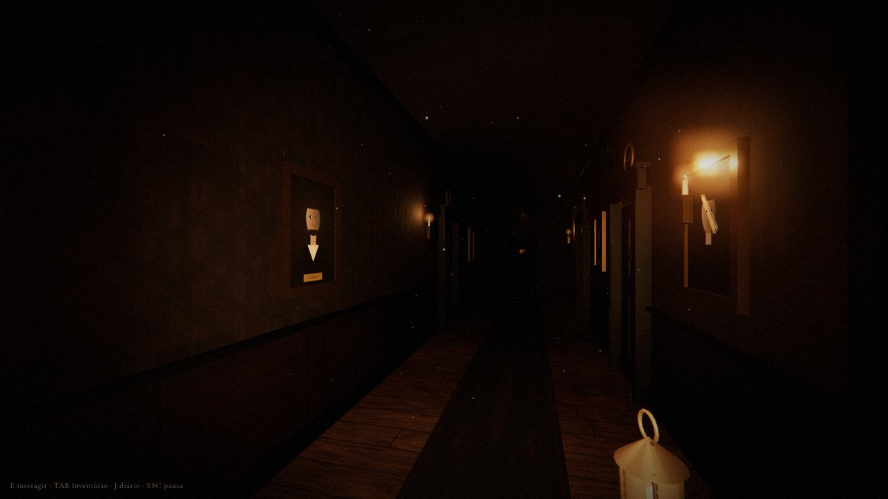
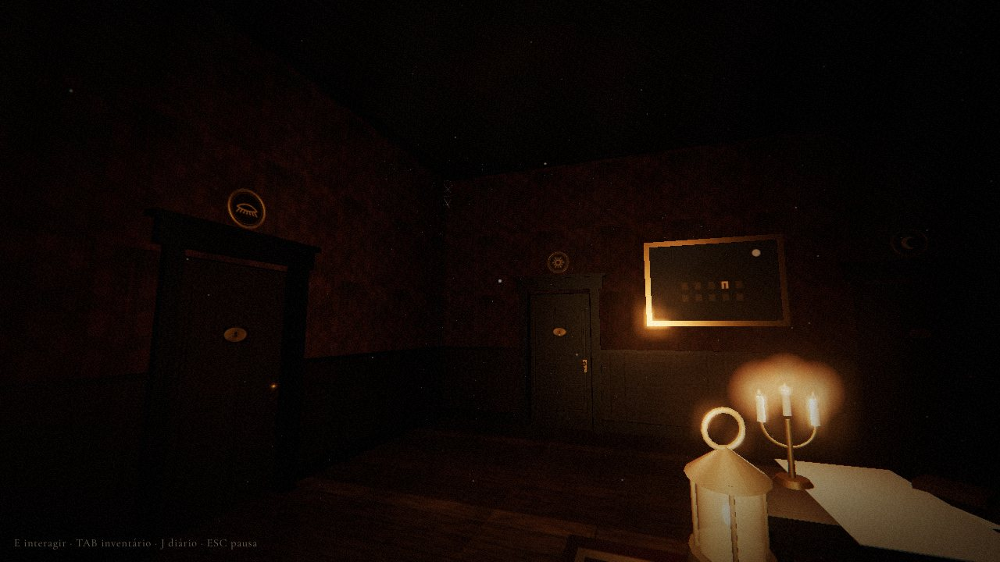
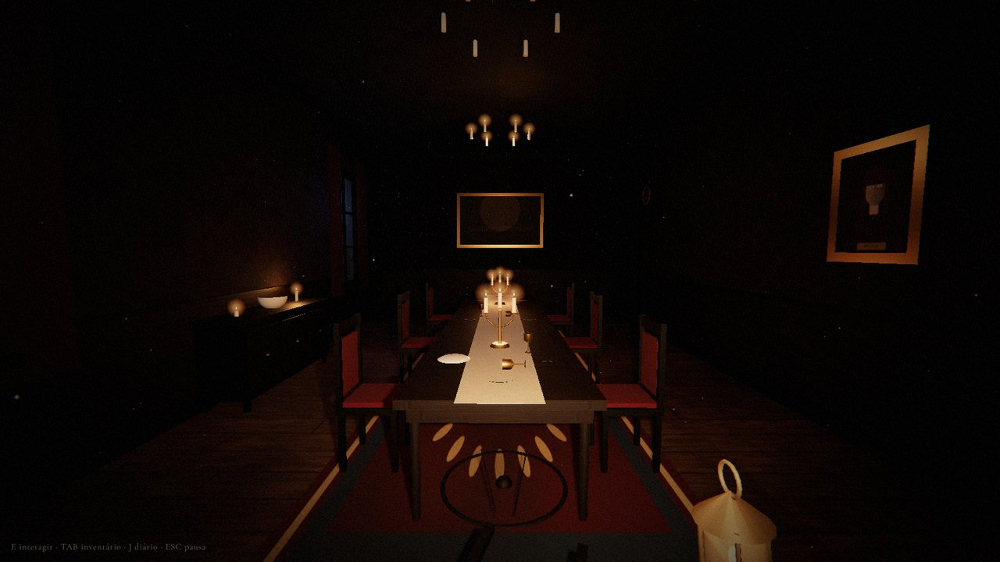
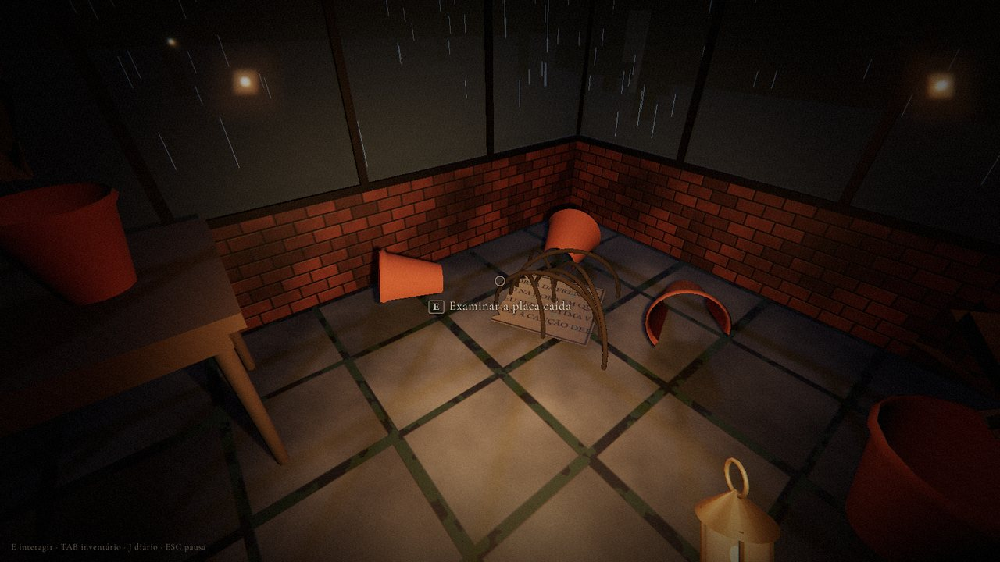
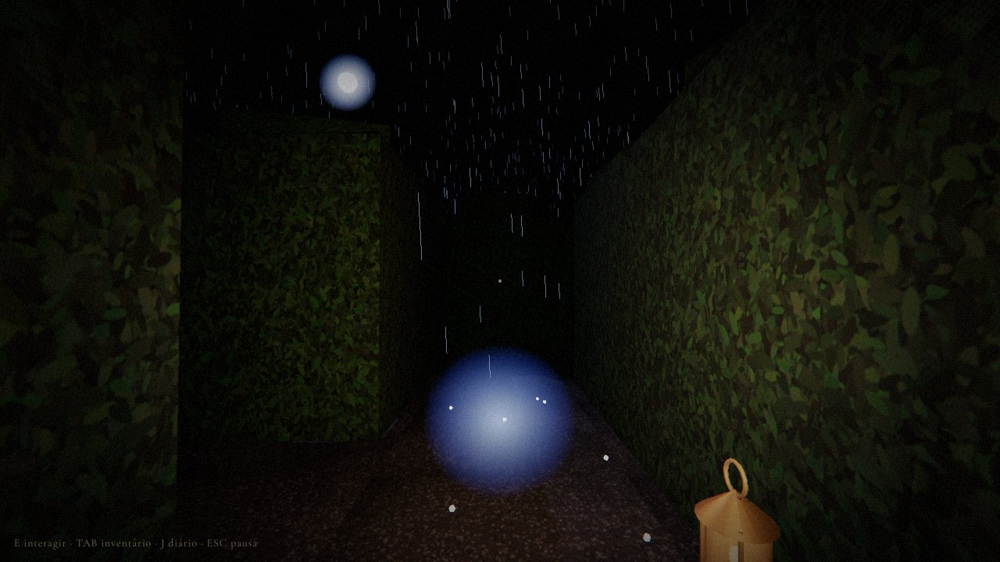
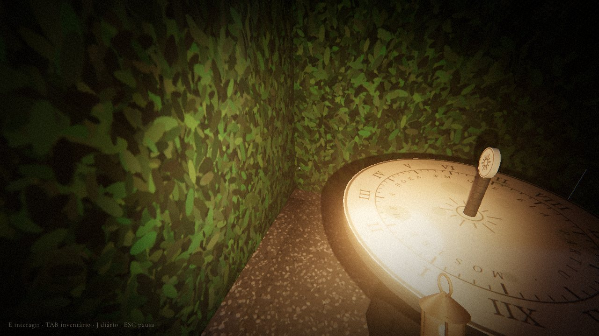

# LIMIAR

**Terror e enigmas em primeira pessoa, em 3D, direto no navegador.**
*A casa tem muitas portas. Só uma é saída.*



Você acorda no vestíbulo de uma casa antiga, sem lembrar como entrou. Cada porta mostra o número da sala para onde leva, e algumas mentem. Os quadros, os objetos e as inscrições nas paredes são as pistas. Há uma placa partida ao meio: uma metade na biblioteca, a outra caída no chão, num lugar bem longe dali. Há portas trancadas, passagens secretas, uma história para descobrir e **vários finais**, inclusive um final verdadeiro, o mais difícil de achar.

Inspirado na mecânica do livro *MAZE* (Christopher Manson). A casa, a história, as salas e os enigmas são originais.

## Jogar

- **No navegador:** a página do GitHub Pages deste repositório (é publicada sozinha a cada envio para a `main`).
- **No computador, a partir do código:**

```bash
npm install
```

```bash
npm run dev
```

## Controles

| | Computador | Celular / tablet |
|---|---|---|
| Andar | `W A S D` | arraste o dedo no **lado esquerdo** da tela (sem joystick desenhado: o ponto onde você encosta vira o centro) |
| Olhar | mouse | arraste o dedo no **lado direito** |
| Correr | `Shift` | empurre o dedo até o limite, para a frente |
| Agachar | `C` | |
| Interagir | `E` ou clique | o anel que aparece quando há algo para usar, ou um toque rápido no lado direito |
| Inventário / Diário | `Tab` / `J` | ícones discretos no canto superior |
| Pausa | `Esc` | ícone de pausa |

## Progresso salvo

- O jogo **salva sozinho** ao atravessar portas, pegar itens, resolver enigmas e a cada 15 segundos.
- Os **finais descobertos** ficam guardados mesmo se você começar um novo jogo.
- Para continuar em outro aparelho: **Menu → Código de progresso**. Copie o código num aparelho e cole no outro.

## Instalar (PC e celular)

No menu do jogo, toque em **Instalar o jogo**. Ele vira um aplicativo com ícone próprio, abre em tela cheia, funciona sem internet e **se atualiza sozinho** sempre que uma versão nova é publicada. O progresso salvo continua lá.

## O jogo

Um único lugar, todo conectado: a casa, o jardim, o andar de cima e o que existe debaixo da terra. O que você encontra no começo serve lá na frente, e o que está lá na frente te faz voltar ao começo. O jogo está sendo construído aos poucos, sempre seguindo o mapa completo em [`docs/DESIGN.md`](docs/DESIGN.md).

**Já dá para jogar:** a casa inteira (térreo e andar de cima, com sótão e observatório), o Jardim, o Labirinto, a Capela e a Casa do Jardineiro. São cerca de 25 salas, mais de 25 enigmas encadeados, 2 finais, 5 dos 7 cacos de espelho e as 10 fichas que abrem a porta de pedra da Adega. A próxima área é o subterrâneo.

| | |
|---|---|
|  |  |
|  |  |
|  |  |

## Tecnologia

- [three.js](https://threejs.org/) + [Vite](https://vitejs.dev/), em JavaScript puro.
- **Nenhum arquivo de arte ou áudio:** texturas, móveis, quadros e toda a música e os efeitos sonoros são gerados por código, na hora.
- Pós-processamento com bloom, vinheta, granulação de filme e aberração cromática.

O design completo (o mapa inteiro, a história, todos os enigmas e todos os finais) está em [`docs/DESIGN.md`](docs/DESIGN.md). **Contém spoilers.**
